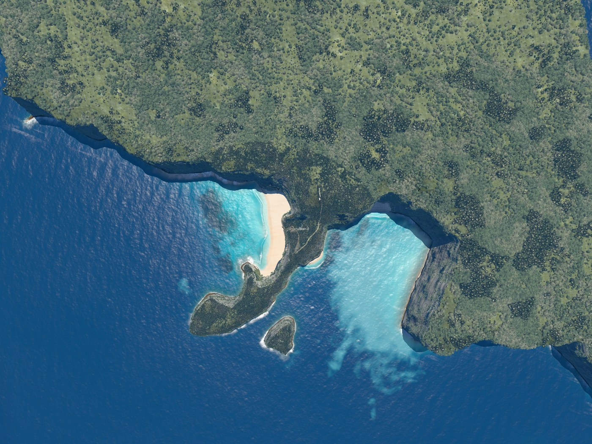
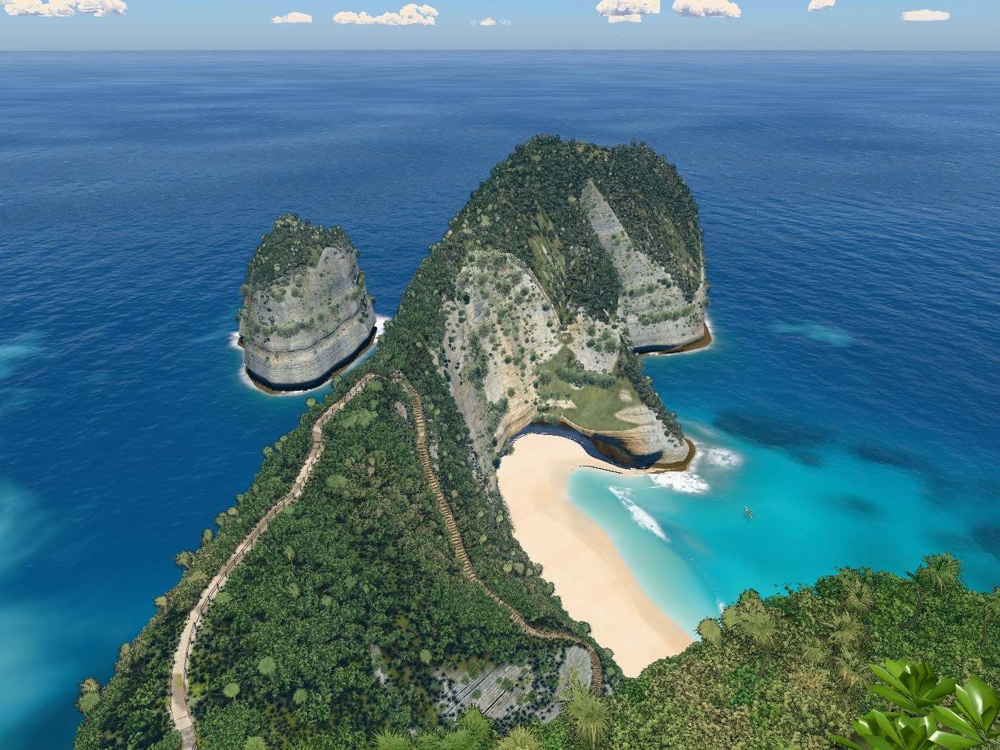
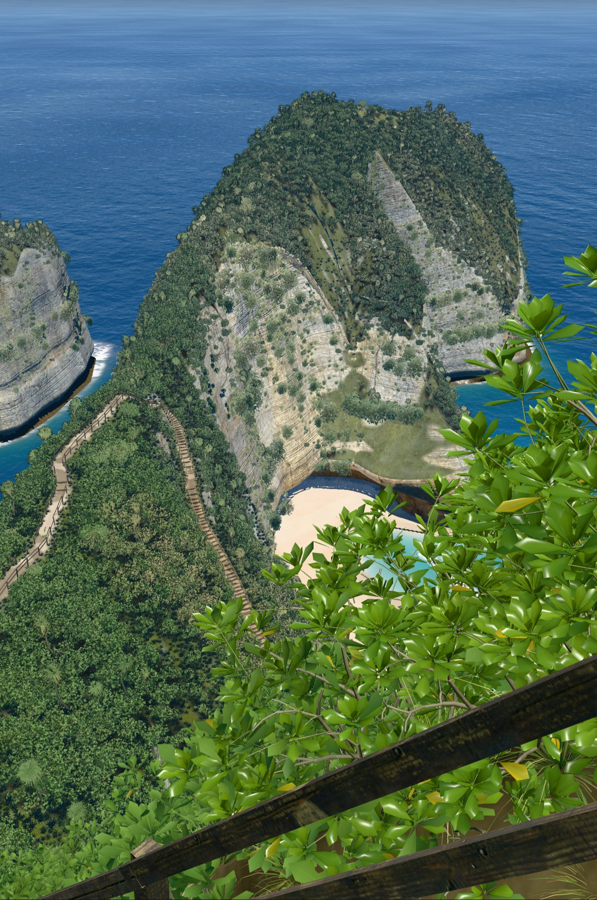
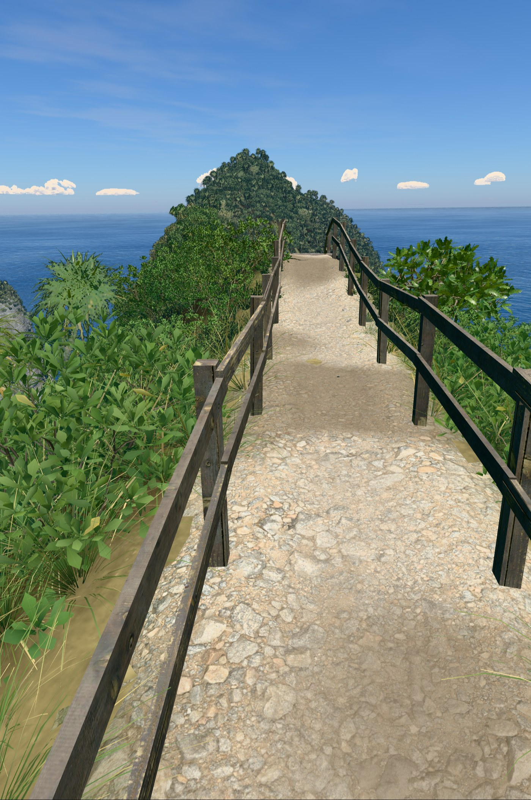
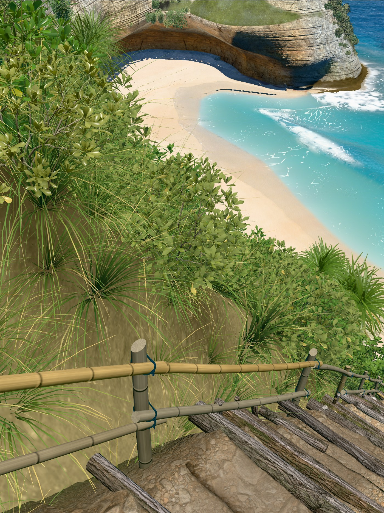
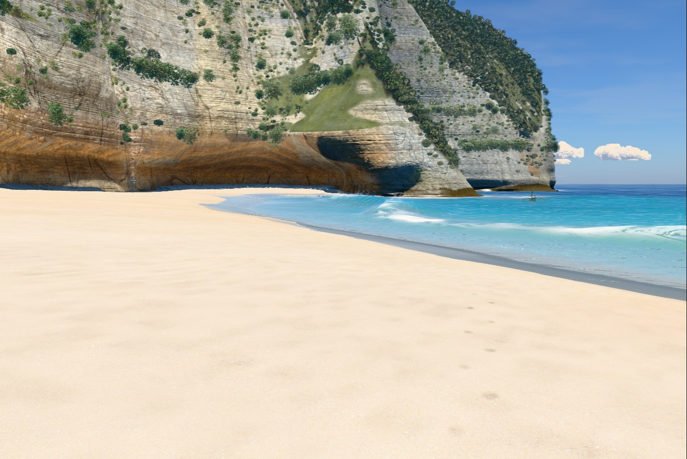
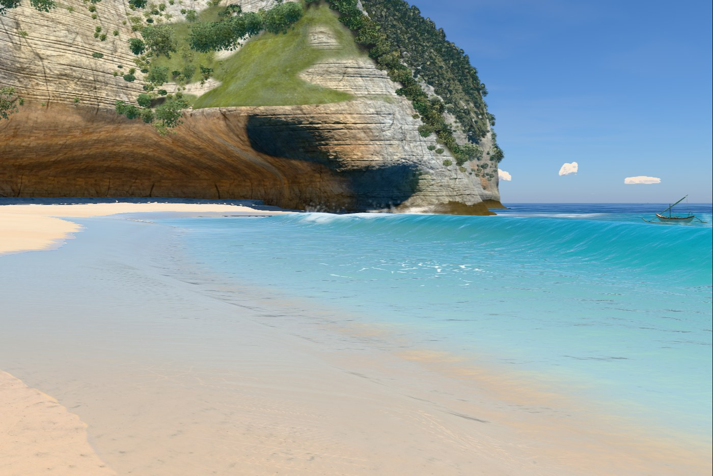
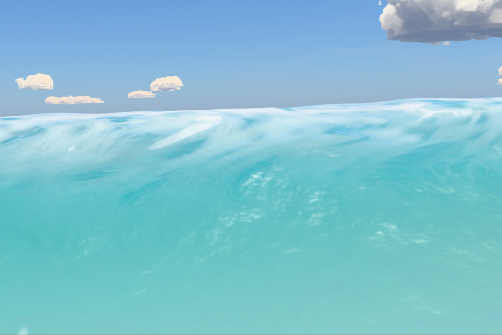
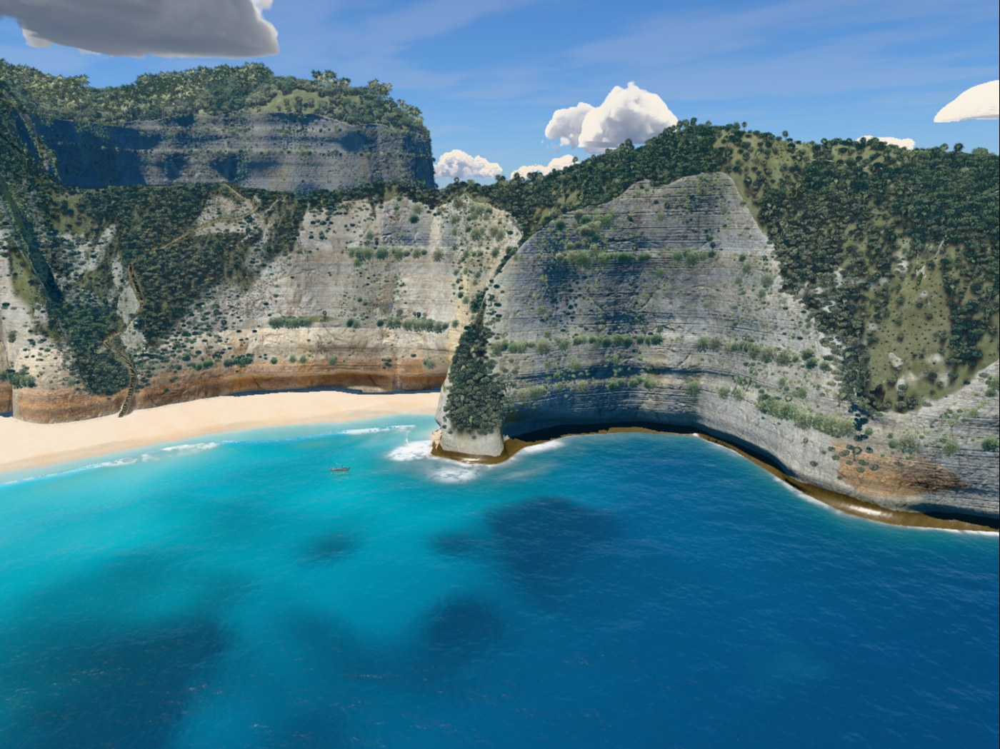

# v35

Hero frames, rendered with `node tools/hero.mjs v35`. The sea is frozen at 17 s.

### Overview, straight down

### Clifftop viewpoint

### On the stairs

### Top of the trail

### Low on the trail

### On the sand

### At the water's edge

### Shore break, eye level

### Head from the sea

## Frame times

Time to render one frame to completion at 1400 px wide, pixel ratio 1, best of 3 rounds, on
the build machine (Apple M1 Max). Absolute times depend on what else is using the GPU, so only
the change column means anything: it is against v34, timed in the same run.

| Frame | Time | fps | Change |
|---|---|---|---|
| Overview, straight down | 18.5 ms | 54 | +0% |
| Clifftop viewpoint | 13.2 ms | 76 | +7% |
| On the stairs | 15.8 ms | 63 | +3% |
| Top of the trail | 11.4 ms | 88 | +10% |
| Low on the trail | 14.2 ms | 70 | +1% |
| On the sand | 13.3 ms | 75 | +0% |
| At the water's edge | 16.6 ms | 60 | +9% |
| Shore break, eye level | 14.3 ms | 70 | +4% |
| Head from the sea | 13.8 ms | 72 | +6% |
